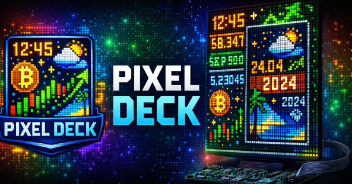

# 🖥️ Pixel Deck


[](https://github.com/petrsafrata/Pixel_Deck/actions/workflows/release.yml)
[](https://github.com/petrsafrata/Pixel_Deck/actions/workflows/publish-base.yml)
[](https://github.com/petrsafrata/Pixel_Deck/actions/workflows/docs.yml)

---

## 📌 Project Description

**Pixel Deck** is a modular Python application designed to control a 64×64 RGB LED matrix (e.g. running on a Raspberry Pi with [`rpi-rgb-led-matrix`](https://github.com/hzeller/rpi-rgb-led-matrix/tree/master)).  

It renders dynamic scenes such as clock, weather, stock market data, cryptocurrency prices, images, and custom text.

The system is built around a modular scene architecture, centralized YAML configuration, and hardware-independent rendering logic. It supports both a development **Window renderer** and a production **Matrix renderer** for physical HUB75 LED panels (via Docker).

Pixel Deck also includes an integrated **Web Control Center**, powered by FastAPI and React, which provides runtime monitoring and configuration without requiring manual changes to the YAML configuration file.

---

## 🎯 Project Goals

- Provide a clean and extensible scene-based LED display framework
- Keep scenes modular, reusable, and self-contained
- Support both physical LED matrices and development rendering
- Provide centralized YAML-based configuration
- Allow runtime configuration through the integrated Web Control Center
- Make adding new scenes simple and consistent
- Support reproducible Raspberry Pi deployment through Docker
- Maintain clean logging and a structured architecture

---

## 🔌 Setup

### 🛠 Used Technologies
- Python 3.12+
- FastAPI
- React
- TypeScript
- Vite
- `rpi-rgb-led-matrix`  (via Raspberry Pi)
- Docker & Docker Compose
- YAML configuration

### 🧩 Used Hardware
- Raspberry Pi 4 / 5
- Adafruit RGB Matrix HAT
- 64×64 RGB LED panel (HUB75, typically 1/32 scan)

---

## 🔗 Wiring Overview (Based on Adafruit Documentation)
This setup follows the official guide from Adafruit:  
https://learn.adafruit.com/adafruit-rgb-matrix-plus-real-time-clock-hat-for-raspberry-pi/matrix-setup

### 🧩 Step 1 – Mount the HAT

- Place the **Adafruit RGB Matrix HAT** directly onto the Raspberry Pi GPIO header
- Ensure all pins are properly aligned

### ⚡ Step 2 – Power the Panel


- Use a **separate 5V power supply**
- Connect:
  - VCC → panel power input
  - GND → panel ground

> [!Important]
> Do NOT power the panel from Raspberry Pi
> Always share **common ground** between PSU and Raspberry Pi

### 🔌 Step 3 – Connect the HUB75 Cable


- Connect the ribbon cable:
  - HAT → panel **INPUT**
- Pay attention to:
  - Arrow direction on panel (IN → OUT)
  - Red stripe on cable = Pin 1

### 🔁 Signal Flow

***Raspberry Pi → HAT → HUB75 Cable → LED Panel***

### 🔧 E Line Fix (Important)

Some 64×64 panels require remapping:

- The **E line must be connected to GPIO 8**
- Often requires **manual rewiring or soldering**


**Symptoms without fix:**
- Shifted rows
- Broken rendering
- Random flickering

---

## 🎬 Supported Scenes

Currently implemented scenes:

| Scene         | Description                                    |
|---------------|------------------------------------------------|
| `clock`       | Digital clock (configurable format & timezone) |
| `calendar`    | Current date (DD.MM + YYYY)                    |
| `weather`     | Weather from Open-Meteo API                    |
| `bitcoin`     | Bitcoin price from CoinGecko                   |
| `sp500`       | S&P 500 data from Stooq                        |
| `text`        | Dynamic multi-line text with word wrapping     |
| `images`      | Random image display                           |
| `day_state`   | Day state from Open-Meteo API                  |
| `f1_calendar` | F1 next race from Jolpi API                    |

>[!NOTE]
>All scenes share a standardized lifecycle and configuration structure.

---

## ⭐ Key Features

- 🧩 Modular and extensible scene architecture
- ⚙ YAML-based configuration
- 🌐 Integrated Web Control Center
- 👁 Live display preview
- 🔁 Configurable scene rotation
- ↕️ Drag-and-drop scene ordering
- 🎛 Runtime scene configuration
- 🖼 Image gallery and image uploads
- 📡 External API integrations
- 🧠 Smart text wrapping and scaling
- 🪟 Window renderer for local development
- 💡 RGB Matrix renderer for Raspberry Pi
- 🪵 Structured runtime logging
- 🐳 Docker-based Raspberry Pi deployment

---

## 🌐 Web UI (FastAPI + React)

Pixel Deck includes an integrated **Web Control Center** for managing and monitoring the display without manually editing the YAML configuration.

The Web UI provides:
- Live display preview
- Scene enable/disable controls
- Drag-and-drop scene ordering
- Scene-specific configuration
- Display power control
- Image gallery and uploads
- Runtime log viewer
- Application controls
- API security configuration

The frontend is built with **React, TypeScript, and Vite**, while the backend API is provided by **FastAPI**.

The Web Control Center works with both the Window and Matrix renderers.

It can be enabled through `config/config.yml`:

```yaml
web:
  enabled: true
  host: "0.0.0.0"
  port: 8080
  api_token: "CHANGE_ME"
  allow_restart: true
  allow_display_power_control: true
  allow_debug_logging: true
```
>[!IMPORTANT]
>Always change the default API token before exposing the Web Control Center on your network.

---

## 📂 Project Structure

```text
Pixel_Deck/
├── assets/
│   └── images/
├── config/
│   └── config.yml
├── docs/
├── frontend/
│   ├── src/
│   ├── package.json
│   └── README.md
├── src/
│   ├── core/
│   ├── gfx/
│   ├── renderer/
│   ├── scenes/
│   └── web/
├── main.py
├── requirements.txt
├── deploy.sh
├── Dockerfile
├── Dockerfile.base
└── docker-compose.yml

```

---

## 🏗 Architecture Overview

Pixel Deck is divided into three main parts: the scene system, the rendering layer, and the Web Control Center.

```text
Pixel Deck
│
├── Scene System
│   ├── BaseScene
│   └── Scene implementations
│
├── Renderer
│   ├── WindowRenderer
│   └── MatrixRenderer
│
└── Web Control Center
    ├── FastAPI backend
    └── React frontend
```

The **Scene System** contains the display logic and individual scene implementations.

The **Renderer** provides a hardware-independent output layer. `WindowRenderer` is used for local development and testing, while `MatrixRenderer` renders the output on a physical RGB LED matrix.

The **Web Control Center** provides runtime monitoring and configuration through a FastAPI backend and React frontend.

### Scene-Based Architecture

Every scene inherits from the common `BaseScene` class, which defines the shared scene lifecycle and provides common functionality used across scene implementations.

```text
BaseScene
│
├── ClockScene
├── CalendarScene
├── WeatherScene
├── BitcoinScene
├── SP500Scene
├── TextScene
├── DayStateScene
├── F1CalendarScene
└── ImagesRandomScene
```

`BaseScene` provides the common foundation for all scenes, including lifecycle management, shared configuration properties, renderer access, and scene metadata.

Individual scene classes are responsible for their scene-specific logic, such as fetching external data, loading assets, maintaining scene state, and rendering content.

This design keeps scenes isolated from each other and makes it possible to add or modify a scene without changing the core rendering architecture.

### Scene Lifecycle

All scenes inherit from `BaseScene` and follow the same lifecycle:

```python
class ExampleScene(BaseScene):

    def on_enter(self) -> None:
        super().on_enter()
        # initialize scene-specific state

    def update(self, dt: float) -> None:
        # update scene state and render content
        ...

    def on_exit(self) -> None:
        # clean up scene-specific resources
        super().on_exit()
```

The lifecycle consists of three main methods:
- `on_enter()` – called once when the scene becomes active
- `update(dt)` – called repeatedly while the scene is active; dt contains the elapsed time since the previous update
- `on_exit()` – called once when the scene is deactivated

`BaseScene` also provides shared scene properties such as:
- `fps` – target frame rate
- `duration_s` – how long the scene remains active
- `background` – configured background color
- `bg_rgb` – background color converted to an RGB tuple

In addition to the runtime lifecycle, each scene can declare class-level metadata used by the scene registry and Web Control Center:
- `scene_name`
- `scene_label`
- `scene_description`
- `scene_capabilities`
- `scene_field_specs`

This keeps scene behavior consistent while allowing each scene to define its own rendering logic, configuration, and Web UI capabilities.

---

## ⚙ Configuration

Pixel Deck uses `config/config.yml` as the central source of application configuration.

Configuration can be managed in two ways:

- **YAML configuration** – provides access to the complete Pixel Deck configuration.
- **Web Control Center** – allows selected scene settings to be changed at runtime through automatically generated configuration forms.

Changes made through the Web Control Center are persisted back to `config/config.yml`.

### Global Sections

The configuration is divided into several main sections:

- `display` – hardware and matrix settings
- `scene_defaults` – shared fallback values for scenes
- `app` – application runtime behavior
- `web` – Web Control Center and API settings
- `scenes` – individual scene configuration

### Example Scene Configuration

```yaml
scenes:
  clock:
    enabled: true
    duration_s: 5
    format: "%H:%M"
    layout:
      time:
        y: 22
        scale: 2
```

Individual scenes can override shared defaults and define their own scene-specific configuration, including values such as:

- `duration_s`
- `refresh_s`
- `fps`
- `background`
- `font`
- `layout`
- `data`

The exact configuration available depends on the scene implementation.

### Web UI Configuration

Selected scene settings can also be edited through the Web Control Center.

Editable fields are declared by each scene using `FieldSpec` metadata. The Web UI uses this metadata to dynamically generate the appropriate configuration controls, so the frontend does not need scene-specific forms.

Common editable fields shared across multiple scenes include:

| Field | Description |
|---|---|
| `duration_s` | How long the scene remains visible |
| `refresh_s` | How often external or dynamic data is refreshed |
| `fps` | Target frame rate of the scene |
| `background` | Scene background color |
| `font.primary_color` | Primary text color |
| `font.secondary_color` | Secondary or accent text color |

Scenes can expose additional editable fields specific to their functionality, such as data source settings, formatting options, text content, or image selection.

The Web UI supports multiple field types, including:

- Boolean toggles
- Numeric inputs
- Color pickers
- Text inputs
- Select/dropdown fields
- String lists
- Image galleries

> [!NOTE]
> The Web Control Center exposes only configuration fields explicitly declared as editable by a scene. Advanced or hardware-specific settings can still be configured directly in `config/config.yml`.

---

## 🧠 How Configuration Works

1. `scene_defaults` defines shared fallback values used by scenes.
2. Each scene can override the values it needs in the `scenes` section.
3. Missing scene-specific values fall back to the corresponding shared defaults.
4. Scenes can declare editable configuration fields through `FieldSpec` metadata.
5. The Web Control Center uses these metadata to dynamically generate configuration controls.
6. Changes made through the Web UI are validated and persisted back to `config/config.yml`.

This approach keeps YAML as the central configuration source while providing a convenient Web UI for commonly changed runtime and scene settings.

---

## ➕ Creating a Custom Scene

A custom scene can be added quickly, and its settings can be exposed in the Web UI using class metadata.

### Step 1 – Create Scene File
`src/scenes/my_scene.py`

```python
from src.scenes.base_scene import BaseScene

class MyScene(BaseScene):
    scene_name = "my_scene"
    scene_label = "My Scene"
    scene_description = "Simple custom scene example"

    def on_enter(self) -> None:
        super().on_enter()

    def update(self, dt: float) -> None:
        if self.renderer is None:
            return
        # draw something
```
`scene_name` is required, it is used as the registry key and the scene key in config/config.yml.

### Step 2 - Register Scene in `main.py`

Add it to `main.py` (import + registration in `build_registry()`):

```python
from src.scenes.my_scene import MyScene

def build_registry() -> SceneRegistry:
    reg = SceneRegistry()
    # existing registrations...
    reg.register(MyScene)
    return reg
```

### Step 3 – Add Configuration

In `config/config.yml`:

```yml
scenes:
  my_scene:
    enabled: true
    duration_s: 10
```

### Step 4 – Add to Rotation (rotate mode)

In `config/config.yml`:

```yml
app:
  scene_order:
    - "clock"
    - "my_scene"
```

### Step 5 (Optional) – Expose Scene Settings in Web UI

If you want scene-specific settings to be editable in the Web UI, define `scene_field_specs` (and optionally `scene_capabilities`) on the scene class.

```python
from src.scenes.base_scene import BaseScene
from src.web.field_spec import FieldSpec

class MyScene(BaseScene):
    scene_name = "my_scene"
    scene_label = "My Scene"

    # Optional: enables feature-related UI controls
    scene_capabilities = {
        "supportsAssets": False,
    }

    # Fields rendered in Web UI for this scene
    scene_field_specs = (
        FieldSpec.text("title", "Title", default="Hello"),
        FieldSpec.integer("duration_s", "Duration (s)", default=10, min_value=1, max_value=120),
        FieldSpec.color("background", "Background", default="#000000"),
    )

    def update(self, dt: float) -> None:
        if self.renderer is None:
            return
        # Use values from self.config
        title = str(self.config.get("title", "Hello"))
        # draw title...
```

This step exposes fields in the UI, but your scene still has to read and use those values from `self.config`.

**FieldSpec Quick Reference**

Use the most common field types to keep scene configuration simple:
- `FieldSpec.text(...)` – short text values
- `FieldSpec.integer(...)` – integer values (min_value, max_value)
- `FieldSpec.number(...)` – decimal values
- `FieldSpec.boolean(...)` – true/false switch
- `FieldSpec.select(...)` – one option from a list
- `FieldSpec.color(...)` – hex color value

Keep fields focused and practical. Add only settings that are meaningful for users to edit.

---

## 🖥 Installation (Development)

Pixel Deck can be developed and tested locally without a physical RGB LED matrix by using the **Window renderer**.

### Clone the Repository

```bash
git clone https://github.com/petrsafrata/Pixel_Deck.git
cd Pixel_Deck
```

### Create a Python Virtual Environment

```bash
python -m venv .venv
```

Activate the virtual environment:

**Windows**

```powershell
.venv\Scripts\activate
```

**Linux / macOS**

```bash
source .venv/bin/activate
```

Install the required Python dependencies:

```bash
pip install -r requirements.txt
```

### Configure the Development Renderer

For local development, configure Pixel Deck to use the Window renderer in `config/config.yml`:

```yaml
app:
  render: "window"
```

Then start the application:

```bash
python main.py
```

> [!TIP]
> The Window renderer provides a local simulation of the 64×64 LED matrix and does not require Raspberry Pi hardware or a connected HUB75 panel.

The Web Control Center frontend can also be run separately in development mode. See [`frontend/README.md`](frontend/README.md) for frontend setup and development instructions.

---

## 🐳 Deployment on Raspberry Pi (Docker Compose)

Pixel Deck is designed to run on Raspberry Pi using Docker and Docker Compose.

The application Docker image is built on top of the **Pixel Deck base image**, which provides the required Python environment, native dependencies, `rpi-rgb-led-matrix` library, and Raspberry Pi compatibility patches.

The application image also builds the React frontend and includes the compiled Web Control Center in the final runtime image.

### Deploy Pixel Deck

After cloning or downloading the project, make the deployment script executable:

```bash
chmod +x deploy.sh
```

Then deploy Pixel Deck:

```bash
./deploy.sh
```

The deployment script prepares the required runtime directories and permissions, builds the application image, and starts Pixel Deck using Docker Compose.

After deployment, the container runs in the background and can be managed using standard Docker Compose commands.

### Useful Commands

| Command | Description |
|---|---|
| `docker compose ps` | Show the current container status |
| `docker compose logs -f` | Follow Pixel Deck application logs |
| `docker compose stop` | Stop Pixel Deck |
| `docker compose start` | Start the stopped container |
| `docker compose restart` | Restart Pixel Deck |
| `docker compose down` | Stop and remove the container |
| `docker compose up -d` | Create and start the container |
| `./deploy.sh` | Rebuild and redeploy Pixel Deck |

> [!NOTE]
> Use `./deploy.sh` when deploying a new version or rebuilding the application. For normal start, stop, restart, and log operations, use the corresponding Docker Compose commands.

If the Web Control Center is enabled, it can be accessed from another device on the same network at:

```text
http://<raspberry-pi-ip>:8080
```

### 🔐 Requirements & Permissions

- Raspberry Pi 4 or newer
- Compatible HUB75 RGB LED matrix
- Correct hardware mapping for the connected matrix
- Docker and Docker Compose
- Docker container must run in `privileged` mode for:
    - SPI and GPIO access
- The container must have access to `/dev/mem:/dev/mem` for:
    - Mapping physical memory device (needed for low-level LED matrix control)
- Module `snd_bcm2835` must be disabled in RPi:
    - This module uses hardware resources that interfere with the LED matrix
    - Disable audio in config:
    ```bash
    sudo nano /boot/config.txt
    dtparam=audio=off
    ```
    - Create or edit blacklist config:
    ```bash
    sudo nano /etc/modprobe.d/blacklist-snd.conf
    blacklist snd_bcm2835
    ```

---

## 🧠 Why the Base Image Patches Pillow

The `rpi-rgb-led-matrix` Python bindings use an **unsafe fast-path for Pillow images**, which accesses image memory directly for better performance.  

In this project (especially inside Docker), this caused:
- build instability of `rgbmatrix.core`
- rendering glitches and incorrect colors
- unpredictable crashes

To ensure stability, the Dockerfile:
- disables the unsafe Pillow fast-path (replaces it with a safe stub)
- forces `SetImage(..., unsafe=False)` by default
- explicitly blocks the unsafe mode

### Tradeoff

- ✅ stable and predictable rendering  
- ❌ slightly lower performance  

For Pixel Deck, **stability is more important than raw speed**, so the safe path is enforced.

---

## 🐞 Troubleshooting

### 🎨 Wrong colors
- Check:
```yml
led_rgb_sequence: "RGB"
```
- Check power supply
    - The HAT has a problem with correct color rendering at high brightness, try reducing the brightness or connecting a separate 5VDC input power supply to the HAT
    ```yml
    brightness: 40
    ```

### ⚡ Flickering pixels
- Increase:
```yml
gpio_slowdown: 10
```
- Adjust:
```yml
pwm_lsb_nanoseconds: 200–300
```

### 🧱 Distorted output
- Check resolution:
```yml
rows: 64
cols: 64
```
- Verify E → GPIO8

### 🔒 Web UI cannot update configuration

Make sure Pixel Deck was deployed using:

```bash
./deploy.sh
```

---

## ⚠ Known Issues

- Some panels require manual E-line fix
- Cheap power supplies cause instability
- Docker adds slight rendering overhead
- High brightness may require dual power input
- Incorrect power supply is the #1 cause of color issues and flickering

---

## 🤝 Contributing

Contributions are welcome!
Feel free to open issues, feature requests, or pull requests to improve the project, add new scenes, enhance performance, or extend the documentation. Please read the [CONTRIBUTING.md](CONTRIBUTING.md) file for details.

## ⚖️ License

This project is open-source and released under the Apache License 2.0.
You are free to use, modify, distribute, and use it commercially under the terms of the Apache 2.0 license.
See the [LICENSE](LICENSE) file for full details.
```
Apache-2.0 – Copyright (c) 2025 Petr Šafrata
```
---