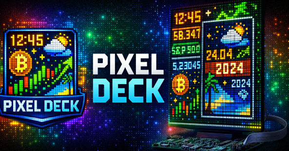

# Pixel Deck Documentation

Pixel Deck is a modular Python application for controlling a 64×64 HUB75 RGB LED matrix, typically connected to a Raspberry Pi.

It combines a scene-based rendering engine, hardware-independent renderers, YAML configuration, Docker deployment, and an integrated Web Control Center built with FastAPI and React.

## Main features

- Modular scene architecture
- YAML-based configuration
- Scene rotation mode
- External API integration (Weather, Crypto, Stocks)
- Image rendering (RGBA support)
- Smart text wrapping & scaling
- Docker deployment on Raspberry Pi
- Structured logging
- Development window renderer

## Documentation

### Getting started
- [Development setup](getting-started/development.md)
- [Raspberry Pi deployment](getting-started/deployment.md)
- [Hardware setup](getting-started/hardware.md)

### User guide
- [Configuration](user-guide/configuration.md)
- [Web Control Center](user-guide/web-control-center.md)
- [Scenes](user-guide/scenes.md)

### Developer guide
- [Architecture](developer-guide/architecture.md)
- [Creating a custom scene](developer-guide/custom-scenes.md)
- [Web configuration schema](developer-guide/field-spec.md)
- [Frontend development](developer-guide/frontend.md)

### Operations
- [Docker and permissions](operations/docker.md)
- [Troubleshooting](operations/troubleshooting.md)
